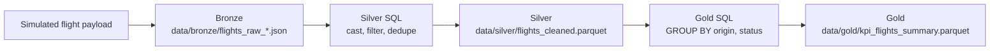

# Local Data Lakehouse

A small medallion lakehouse that ingests simulated flight operations, cleans them, and publishes origin/status KPIs — all on your laptop with DuckDB.

## Overview

This project walks a tiny flight dataset through the classic bronze → silver → gold pattern, without a cloud account or a long-running database.

- **Bronze** writes a timestamped JSON snapshot of the raw payload, including a duplicate flight and a cancelled record with a missing destination, so later steps have something messy to clean.
- **Silver** types the fields, drops rows with a null destination, and keeps one row per `flight_id` + `flight_timestamp`.
- **Gold** aggregates flights and passengers by origin and status into a KPI table.

The ingest step does not call an external API. It generates a fixed sample payload in `src/01_ingest_bronze.py`, which is enough to demonstrate the pipeline end to end. Sample bronze JSON plus the latest silver and gold Parquet files are already in `data/`.

## Tech stack

- Python
- [DuckDB](https://duckdb.org/) `1.5.6` for SQL transforms and Parquet I/O
- Pandas `3.0.6` (used when the scripts preview results with `.df()`)
- JSON for the durable bronze layer, Snappy-compressed Parquet for silver and gold

There is no Docker setup and no environment variables. Pytest covers the silver transform and the gold aggregation (`tests/test_medallion.py`). GitHub Actions runs those tests on push and on pull request.

## Data flow



`src/run_pipeline.py` runs the three steps in order and stops if any script exits with a non-zero status.

### What each layer does

| Layer | Input | Cleaning / logic | Output |
|---|---|---|---|
| Bronze | In-memory sample of 5 records | Adds `_ingested_at` to every row | `data/bronze/flights_raw_YYYYMMDD_HHMMSS.json` |
| Silver | Latest `flights_raw_*.json` | `TRY_CAST` on `passengers` and `timestamp`; drop `destination IS NULL`; `ROW_NUMBER()` partitioned by `flight_id, flight_timestamp`, keep `row_num = 1` (latest `_ingested_at`) | `data/silver/flights_cleaned.parquet` |
| Gold | `flights_cleaned.parquet` | `COUNT`, `SUM`, `AVG` of passengers, grouped by `origin` and `status`, plus `_calculated_at` | `data/gold/kpi_flights_summary.parquet` |

The DuckDB connections are in-memory and closed at the end of each script. The files under `data/` are what actually persists. Each pipeline run adds a new bronze JSON file and **overwrites** the silver and gold Parquet files.

The sample payload includes:

- `LA8001` GIG → GRU, `SCHEDULED`, 180 passengers (duplicated on purpose)
- `G31520` GIG → BSB, `DELAYED`, 142 passengers
- `AD4090` SDU → VCP, `BOARDING`, 110 passengers
- `UNKNOWN` GIG → `null`, `CANCELLED`, 0 passengers (removed in silver)

After silver, that set becomes three cleaned flights. Gold then reports KPIs such as GIG / SCHEDULED and GIG / DELAYED as separate groups.

## How to run locally

From the repository root:

```bash
python3 -m venv venv
source venv/bin/activate   # Windows: venv\Scripts\activate
pip install -r requirements.txt
```

Run the full pipeline:

```bash
python src/run_pipeline.py
```

Or run the layers one at a time, in this order:

```bash
python src/01_ingest_bronze.py
python src/02_transform_silver.py
python src/03_aggregate_gold.py
```

Silver exits early with a message if `data/bronze` has no `flights_raw_*.json` files. Gold exits early if `data/silver/flights_cleaned.parquet` is missing.

`run_pipeline.py` runs each step with the project virtualenv when it exists: `venv/bin/python` on macOS and Linux, and `venv/Scripts/python.exe` on Windows. If that interpreter is not there, it uses the interpreter that launched the orchestrator (`sys.executable`).

Run the tests from the repository root after installing requirements:

```bash
pytest
```

Inspect the gold table with DuckDB:

```bash
python -c "import duckdb; print(duckdb.sql(\"SELECT * FROM 'data/gold/kpi_flights_summary.parquet'\").df())"
```

## Project structure

```
.
├── data/
│   ├── bronze/                 # Timestamped raw JSON snapshots
│   ├── silver/                 # flights_cleaned.parquet
│   └── gold/                   # kpi_flights_summary.parquet
├── src/
│   ├── 01_ingest_bronze.py     # Generate sample payload and write bronze JSON
│   ├── 02_transform_silver.py  # Clean, type, and deduplicate
│   ├── 03_aggregate_gold.py    # Origin/status KPIs
│   └── run_pipeline.py         # Run the three steps in sequence
├── tests/
│   └── test_medallion.py       # Silver transform and gold aggregation
├── .github/workflows/tests.yml # Pytest on push and pull request
└── requirements.txt
```
